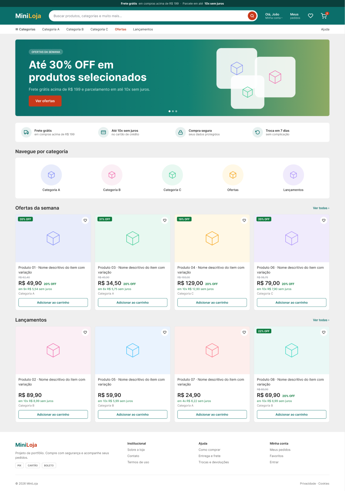
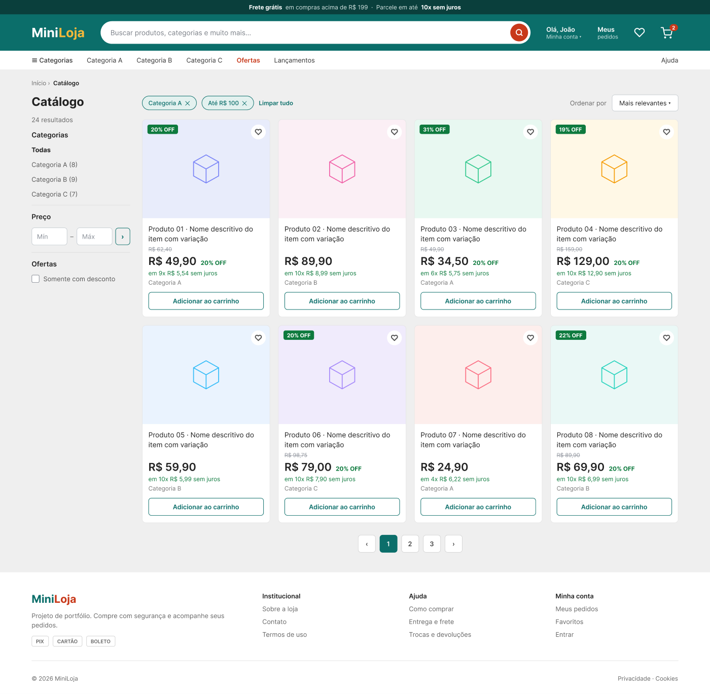
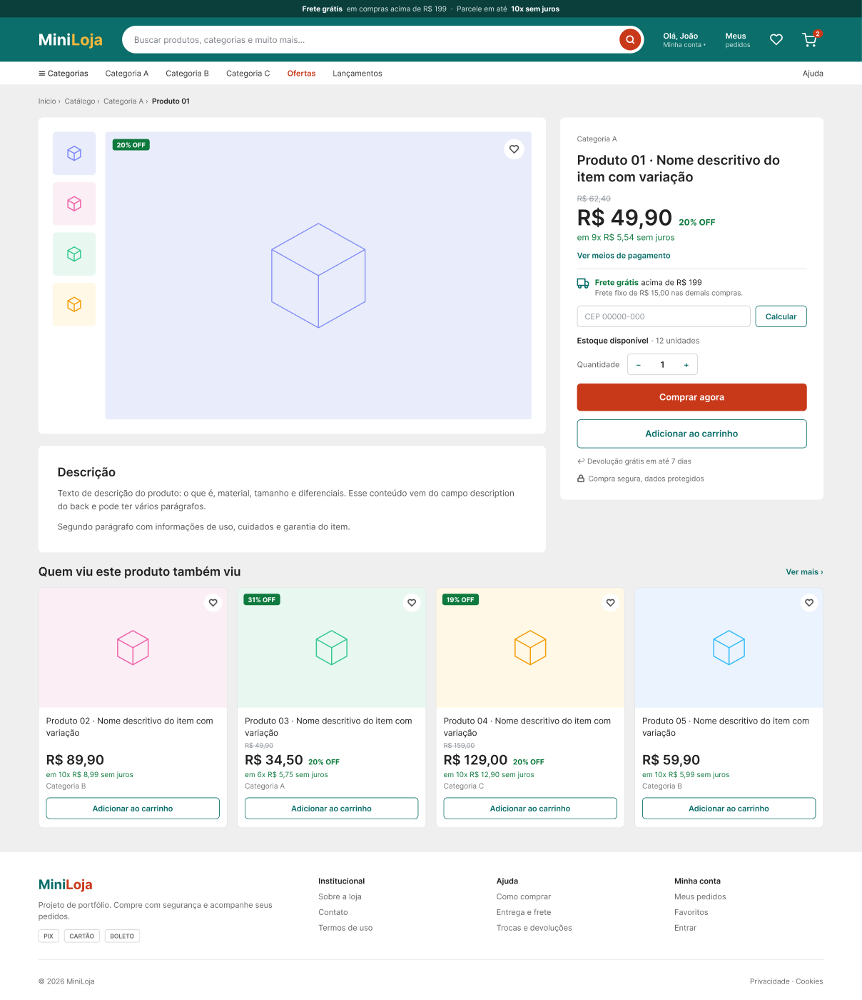
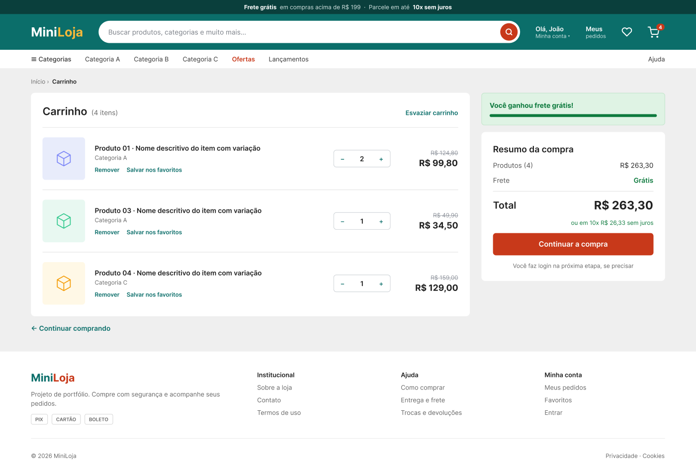
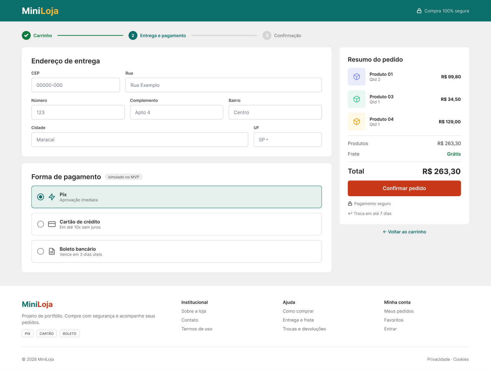
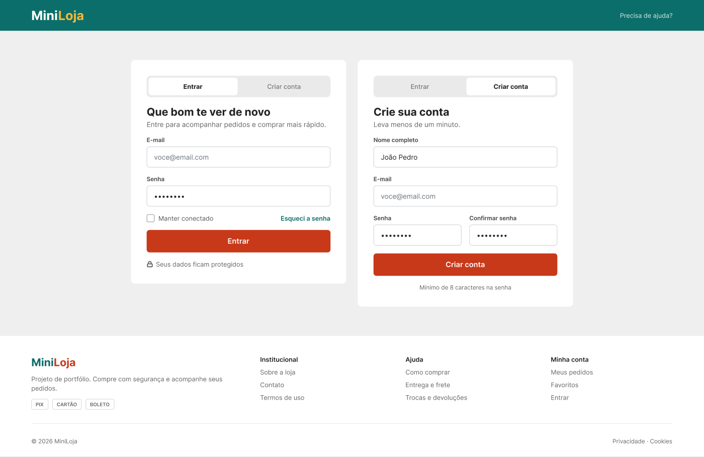
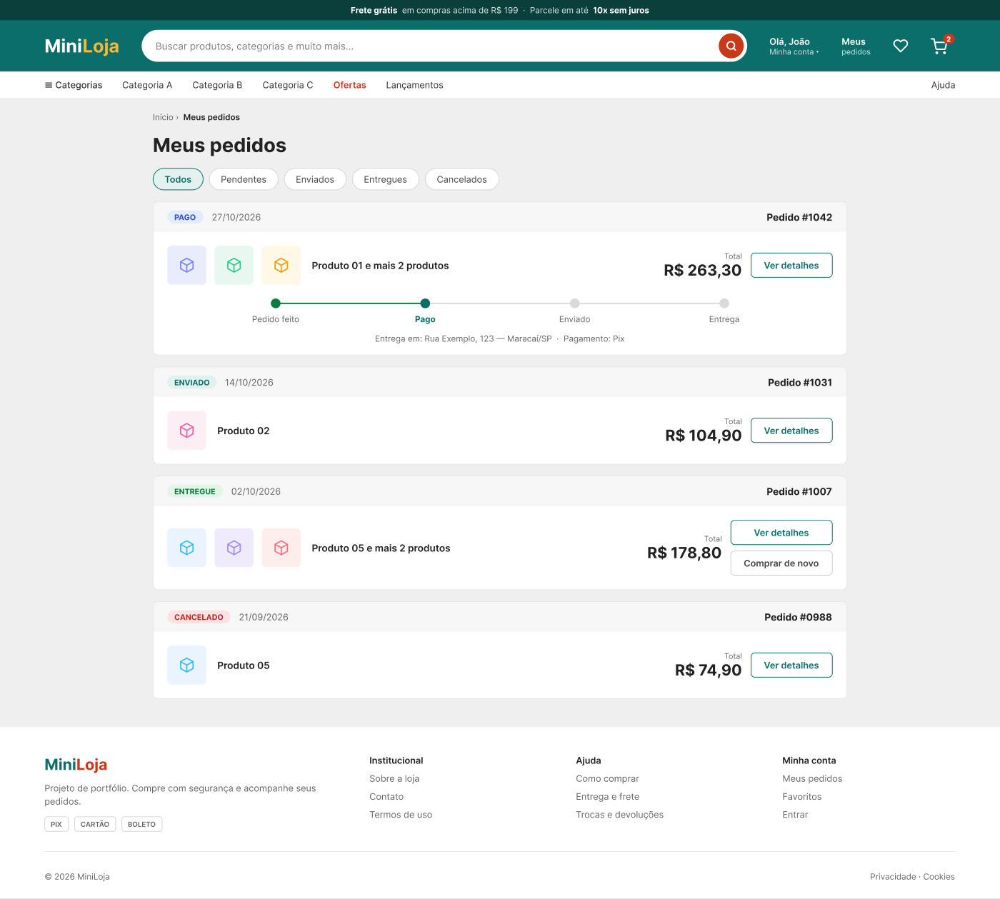
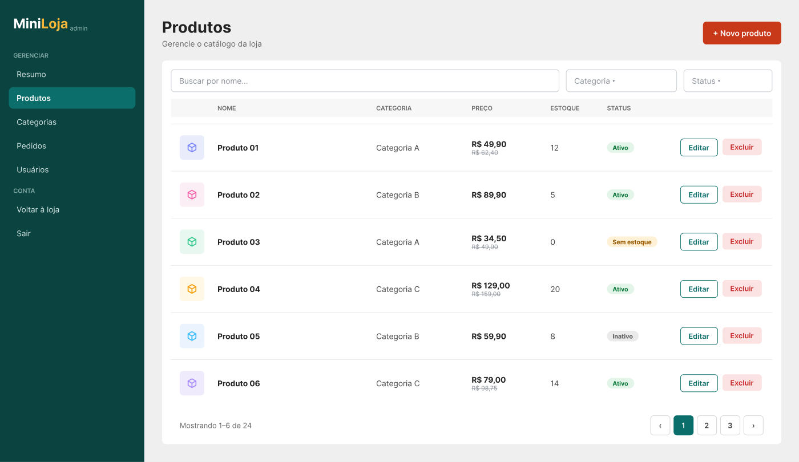
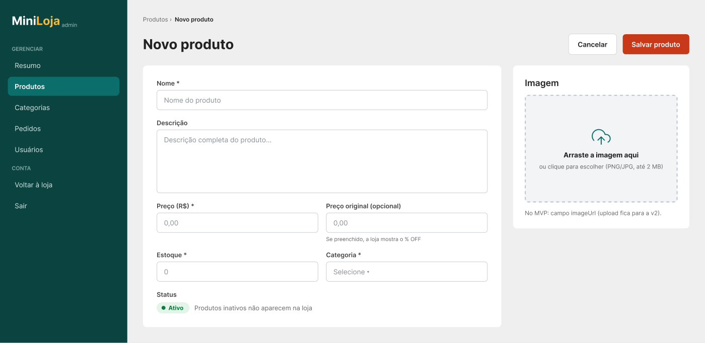
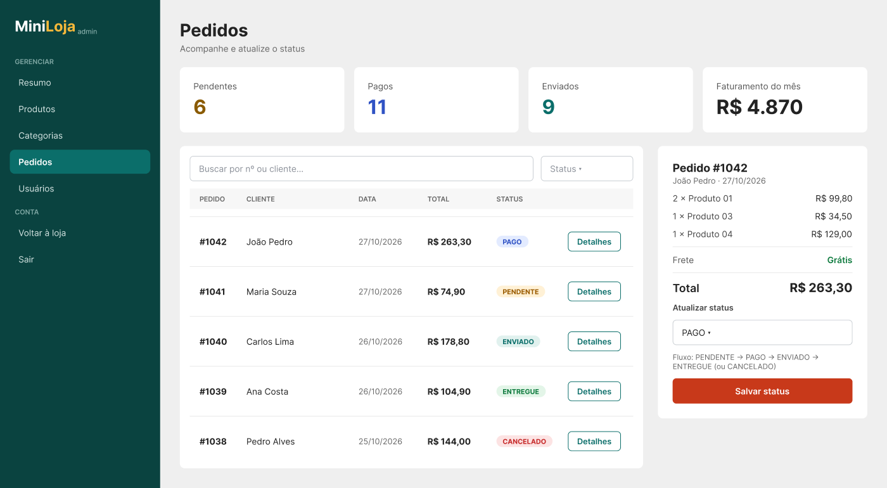

# MiniLoja — Front-end

Front-end da **MiniLoja**, um e-commerce de portfólio: catálogo com filtros, detalhe do produto, carrinho, checkout, pedidos do cliente e painel admin. Feito em **Angular 17** (standalone components + signals), consumindo a API **Java / Spring Boot** descrita em [`PLANEJAMENTO-BACK.md`](PLANEJAMENTO-BACK.md).

Design no Figma: [MiniLoja — Telas](https://www.figma.com/design/sRhX23QH5p82P9ax5JDteW/MiniLoja---Telas). Decisões de arquitetura, rotas e tokens: [`PLANEJAMENTO-FRONT.md`](PLANEJAMENTO-FRONT.md).

## Telas

| Tela | Rota | Acesso |
|---|---|---|
| Home | `/` | público |
| Catálogo | `/catalogo` | público |
| Detalhe do produto | `/produtos/:id` | público |
| Carrinho | `/carrinho` | público |
| Login / Cadastro | `/entrar` | só deslogado (`guestGuard`) |
| Checkout | `/checkout` | logado (`authGuard`) |
| Meus pedidos | `/pedidos` | logado (`authGuard`) |
| Admin · Produtos | `/admin/produtos` | admin (`adminGuard`) |
| Admin · Novo / Editar produto | `/admin/produtos/novo` · `/admin/produtos/:id/editar` | admin |
| Admin · Pedidos | `/admin/pedidos` | admin |

<details>
<summary>Ver as telas do Figma (referência)</summary>

 
 
 
 
 

</details>

## Como rodar

Pré-requisitos: Node 20+ e npm.

```bash
npm ci
npm start            # ng serve em http://localhost:4200
```

| Comando | O que faz |
|---|---|
| `npm start` | servidor de desenvolvimento (proxy de `/api` para o Spring Boot em `:8080`) |
| `npm run build` | build de produção em `dist/mini-loja-front-end` (usa `environment.prod.ts`) |
| `npm test` | testes unitários (Karma + Jasmine), modo watch |
| `npm run test:ci` | testes uma vez, em Chrome headless sem sandbox (`CHROME_BIN` deve apontar para um Chrome/Chromium) |

> O build de produção baixa a fonte Inter do Google Fonts para inlinar o CSS crítico, então precisa de internet.

### Conectando no back

O front sempre chama `environment.apiUrl` (`/api`). No dev, o `proxy.conf.json` encaminha `/api` para `http://localhost:8080`, então o Spring Boot precisa estar no ar e o navegador só fala com `:4200` (não precisa configurar CORS). Se o back rodar em outra porta, mude o `target` em `proxy.conf.json`. Em produção (`environment.prod.ts`) o `/api` deve ser servido pelo mesmo domínio (ou por um proxy reverso).

Não existe usuário nem dado de exemplo no front: login, cadastro e admin dependem dos usuários que existirem no banco do back.

## Arquitetura

```
src/app/
├─ core/                  só o que é transversal ao app (igual ao App Saúde)
│  ├─ auth/               guards/ (role/auth/guest/admin) · services/ (AuthApi, AuthStore)
│  └─ http/               interceptors (auth e erro)
├─ features/              1 pasta por assunto, cada uma com pages/ components/ services/ (models/ quando precisa)
│  ├─ home/  catalog/  cart/  checkout/  orders/  auth/
│  └─ admin/              admin.routes.ts · layout/admin-shell · pages/ · services/
└─ shared/                sem regra de negócio
   ├─ layout/             shop-shell, focus-shell, shop-footer, not-found
   ├─ ui/                 button, badge, icon, logo, product-card, price-block, product-thumb,
   │                      pagination, modal, empty-state, order-status-badge
   ├─ services/           StoreInfoApi / StoreInfoStore
   ├─ pipes/  models/  utils/
```

Cada componente vive na **própria pasta**, com 4 arquivos: `x/x.component.ts` (lógica), `x.component.html` (template), `x.component.scss` (estilos) e `x.component.spec.ts` (testes). O mesmo vale para páginas (`pages/cart/cart.page.*`) e pipes.

**Rotas:** todas as URLs estão em `src/app/app.routes.ts`, agrupadas por shell (enxuto, admin, loja). Só o admin tem arquivo próprio (`features/admin/admin.routes.ts`) porque tem várias páginas internas. Dados de exemplo dos specs ficam em `src/testing/fixtures.ts`.

Regras seguidas (seção 9 do planejamento):

1. `core` só tem auth e http. O que mais de uma feature usa mora na feature "dona" (`CartStore` em `features/cart`, `ProductsApi` em `features/catalog`, `OrdersApi` em `features/orders`) e as outras importam de lá, igual `consulta` no App Saúde. Nada de import circular entre features.
2. Componente não chama `HttpClient`: quem chama é um `*.api.ts`.
3. `shared` não tem regra de negócio. O `product-card` não conhece o carrinho: só emite `(add)`.
4. Dinheiro é formatado pelo `brl` pipe. Frete e total no front são **só para exibir**; o back recalcula no `POST /orders`.
5. Os models em `shared/models` espelham os DTOs do back.

Fluxo de dados: `página → store/api → HttpClient → interceptors (auth, erro) → Spring Boot`. Estado com **signals** (`AuthStore`, `CartStore`, `StoreInfoStore`); filtros do catálogo e dos pedidos vivem na **URL** (query params), então dá para compartilhar o link e o botão voltar funciona. Toda lista tem estados de carregando (skeleton), vazio e erro.

### Onde a implementação difere do `PLANEJAMENTO-FRONT.md`

| Planejamento | Implementado | Motivo |
|---|---|---|
| `features/catalog/data`, `orders/data` | `services/` em cada feature | mesmo nome de pasta do App Saúde |
| Layouts (shells) em `core/layout` | `shared/layout` (e `admin-shell` em `features/admin/layout`) | `core` fica só com auth e http |
| `Product`, `Category`, `Order` em cada feature | `shared/models/` | usados por mais de uma feature |
| `ui-input` como componente | classes globais `.field` / `.input` | formulários são Reactive Forms; classe CSS resolve sem boilerplate |
| Container de 1180px | 1312px | é a largura real das telas do Figma (1440px com margem de 64px) |
| Card com imagem quadrada | proporção ≈ 1,3:1 | é a proporção do card no Figma |

### Endpoints consumidos

| Área | Endpoints |
|---|---|
| Loja | `GET /store-info`, `GET /categories`, `GET /products` (`page, size, search, category, minPrice, maxPrice, onSale, sort`), `GET /products/{id}` |
| Auth | `POST /auth/login`, `POST /auth/register`, `GET /users/me` |
| Pedidos | `POST /orders`, `GET /orders/me`, `PATCH /orders/{id}/cancel` |
| Admin · produtos | `GET /admin/products`, `GET /admin/products/{id}`*, `POST`, `PUT /admin/products/{id}`, `DELETE /admin/products/{id}` (soft delete) |
| Admin · pedidos | `GET /admin/orders`, `GET /admin/orders/summary`, `GET /admin/orders/{id}`, `PATCH /admin/orders/{id}/status` |

\* `GET /admin/products/{id}` não está listado no planejamento. O formulário de edição precisa dele para carregar produtos inativos; se o back não tiver, é só criar.

## Branches

O trabalho foi dividido em uma branch por módulo, **empilhadas** (cada uma parte da anterior). Para integrar, abra os PRs na ordem abaixo, cada um contra a branch anterior (ou apenas faça merge da última, que já contém todas):

| # | Branch | Conteúdo |
|---|---|---|
| 1 | `feat/core-shared` | tokens de design, environments, interceptors, guards, stores, shells (loja / enxuto / admin), UI compartilhada, models |
| 2 | `feat/catalog` | `/catalogo` (filtros na URL) e `/produtos/:id` |
| 3 | `feat/home` | `/` com banner, benefícios, categorias e vitrines |
| 4 | `feat/cart` | `/carrinho` com resumo e barra de frete grátis |
| 5 | `feat/auth` | `/entrar` (login e cadastro) |
| 6 | `feat/checkout` | `/checkout` e `POST /orders` |
| 7 | `feat/orders` | `/pedidos` com filtro, linha do tempo e cancelamento |
| 8 | `feat/admin` | `/admin/produtos`, formulário de produto e `/admin/pedidos` |
| 9 | `docs/readme` | este README e as imagens das telas |

## Design

Paleta, tipografia (Inter) e espaçamentos estão como CSS variables em `src/styles.scss` (tabela completa na seção 8 do planejamento). Cor com função: **verde** só para benefício ao comprador, **laranja** só para a ação principal de compra, **verde-azulado** (marca) para o resto. Produtos sem imagem mostram um placeholder colorido com um cubo (`product-thumb`); com `imageUrl`, mostram a foto.

## Acessibilidade

Labels em todos os campos, foco visível, `aria-current` / `aria-selected` / `aria-pressed` nos controles de estado, modal fechável com Esc e `prefers-reduced-motion` respeitado nas animações. Os tokens de cor mantêm contraste AA (ver seção 8 do planejamento).

## Fora do MVP (v2)

Upload de imagem do produto · cálculo de frete por CEP / ViaCEP · pagamento real · cupom · favoritos (hoje o coração é só visual) · avaliações · dashboard "Resumo", Categorias e Usuários no admin · carrinho sincronizado com o back · tema escuro · i18n.
